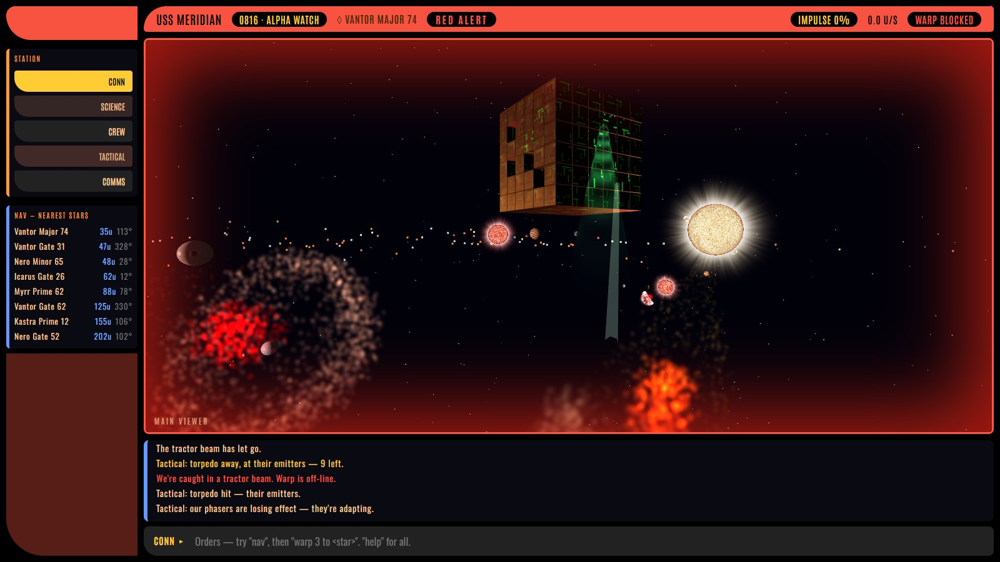
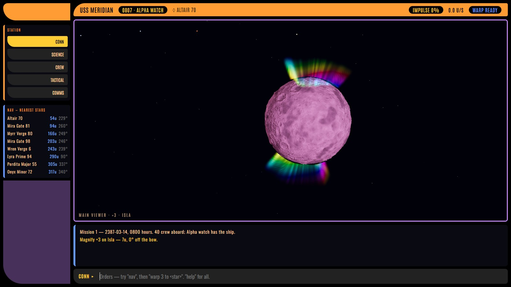
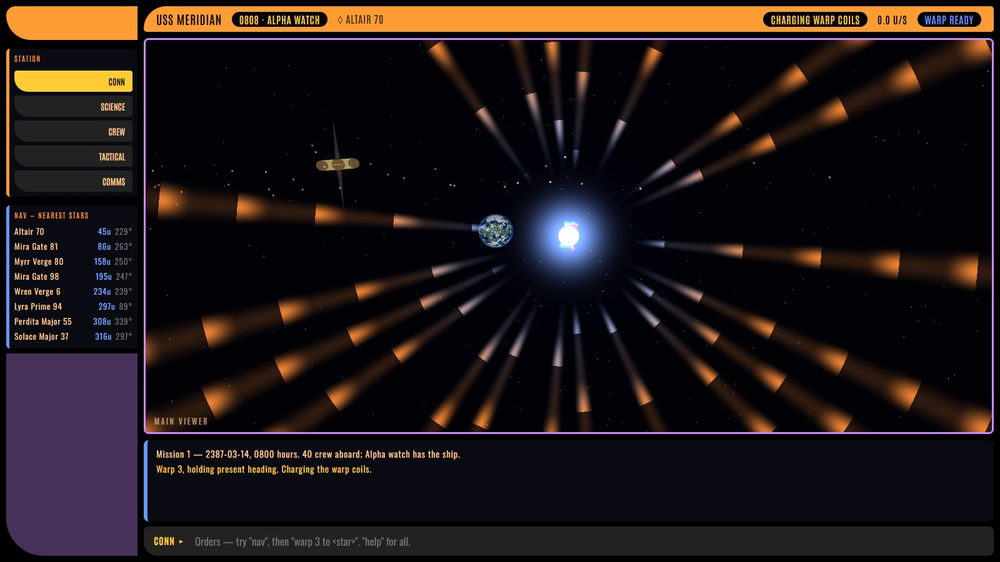
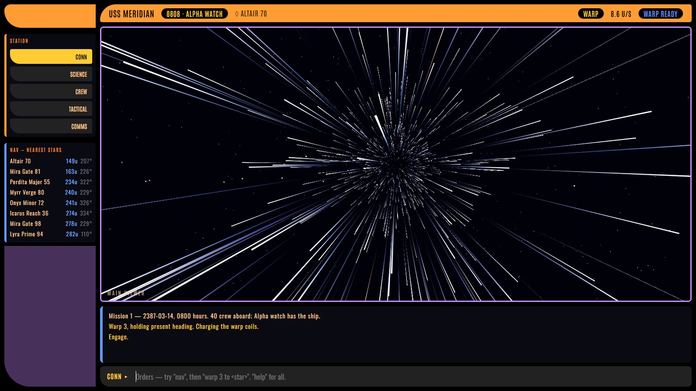
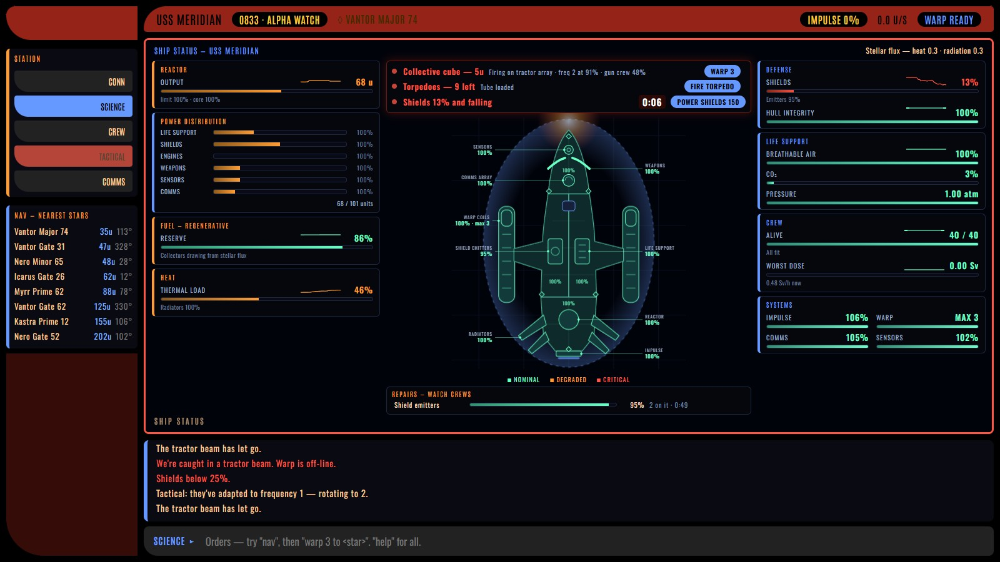
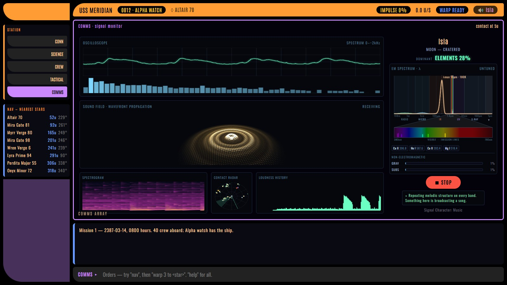
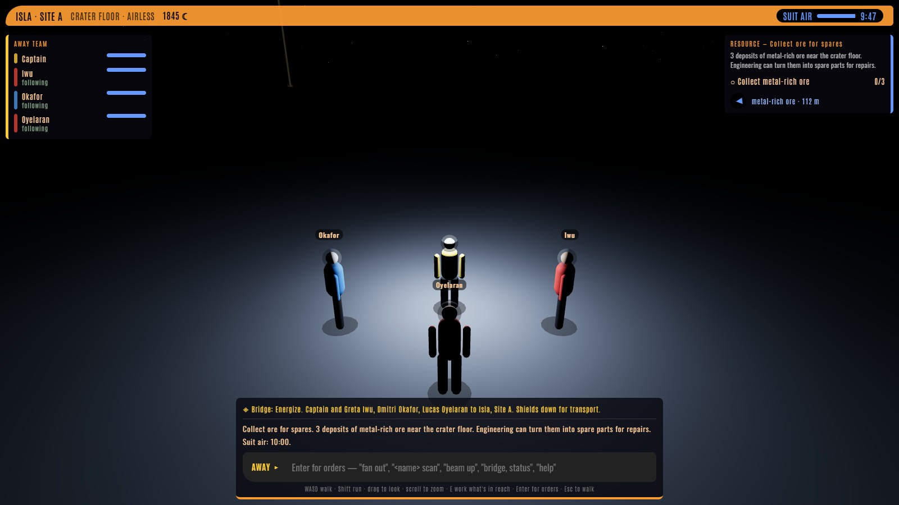

# USS Meridian

**A starship bridge sim you command by typing orders.** Fly a procedurally
generated galaxy of 1,000+ objects, keep a crew of forty alive, survive stellar
flares, fight off a hunting cube, and beam down to explore alien worlds. It runs
in your browser with nothing to install.

### [▶ Play it now](https://kjregan120.github.io/starship-bridge/)

Works best on a desktop browser with a keyboard. Turn your sound on.



## Quickstart

Click the command line at the bottom of the screen, type an order, and press
Enter. These are the three orders you'll use most:

| Order | What it does |
| --- | --- |
| `ahead full` | Full impulse (2 u/s) on your current heading. Also `half`, `quarter`, or `all stop`. |
| `warp 1 to Isla` | Charges the coils, then jumps toward a named destination. Warp factors run from 1 to 3, and warp drops you out 60 u short of the target. |
| `come about to Isla` | Turns toward a target and flies there at impulse, then holds station on arrival. Use it to finish the trip after warp. |

> [!TIP]
> **Warp 1 is the slowest way to travel**, slower even than full impulse. Pick
> your warp factor to suit the distance:
>
> | Speed | u/s | From the start to Isla (about 730 u) |
> | --- | --- | --- |
> | Warp 1 | 0.22 | about 55 minutes |
> | Full impulse | 2.0 | about 6 minutes |
> | Warp 2 | 2.2 | about 5.5 minutes |
> | Warp 3 | 8.6 | about 1.5 minutes |

### Your first five minutes

Isla, a pink moon with a rainbow aurora, makes a good first destination:

1. `warp 3 to Isla` to cross the galaxy. Watch the coils charge on the viewer.
2. `come about to Isla` once the log says you've arrived, to close the last 60 u.
3. `magnify 3 on Isla` to get a good look at it.
4. `comms` to open the COMMS station, then press **LISTEN**. Isla is broadcasting
   a song.
5. `help` at any time lists the orders for the station you're on.



## On the bridge

Five stations share the main screen. Click one on the left, or type its name.

| Station | What it's for | Try |
| --- | --- | --- |
| **CONN** | The main viewer and the helm | `warp 2 to Altair 70`, `port 90`, `drop out`, `magnify 5` |
| **SCIENCE** | Ship systems, power, heat and repairs | `status`, `scan`, `reactor 80`, `power shields 150`, `repair all` |
| **CREW** | The forty aboard, their watches and their files | `crew report`, `call all hands`, `all hands to shelter`, `file <name>` |
| **TACTICAL** | A 3D chart, and weapons in a fight | `engage`, `fire torpedo`, `target emitters`, `stance defensive` |
| **COMMS** | Signals from whatever's nearby | `sweep`, `hail <name>`, `tune subspace`, `decode` |





## What's out there

**A living ship.** Reactor output, power distribution, heat, shields, hull, life
support and radiation dose are all simulated, and damage to one system spreads
to the others. Crews work repairs on their own, and you decide what comes first.



**A crew with careers.** Everyone aboard has a personnel file, stands a watch,
and learns from what they do. Your career carries over between missions, saved
in your browser. Start again with `new career`.

**Dangerous stars.** Stars throw flares and coronal mass ejections that can
reach the ship. If something is cooking you, `withdraw`.

**The Collective.** A cube can find you. Your Tactical crew pick targets and
rotate frequencies on their own, while the cube adapts to your phasers and its
tractor beam blocks warp. Torpedoes are yours to fire, and they can't be adapted
to, but you only carry ten.

**Signals worth listening to.** Every contact has a spectrum you can inspect,
tune, listen to and try to decode.



**Away missions.** Make `standard orbit` of a planet or moon, check `sites` and
your `away team`, then `beam down`. On the surface you walk with WASD and watch
your suit air.



## Run it locally

You'll need [Node.js](https://nodejs.org/).

```bash
npm install
npm run dev
```

Then open the URL Vite prints, usually <http://localhost:5173/starship-bridge/>.

| Command | What it does |
| --- | --- |
| `npm run dev` | Starts the dev server |
| `npm run build` | Builds the production site into `dist/` |
| `npm run preview` | Serves that build locally |
| `npm run test:physics` | Runs the simulation test suite |
| `npm run helm` | Flies the ship from a terminal, with no graphics |

## How it's built

Built with [React](https://react.dev/), [Three.js](https://threejs.org/) through
[React Three Fiber](https://r3f.docs.pmnd.rs/), [Zustand](https://zustand.docs.pmnd.rs/)
and [Vite](https://vite.dev/). All of the game's sound is synthesized in the
browser, so the site ships no audio files.

- `src/universe/` is the simulation: physics, the ship, crew, combat and away
  missions. It's plain JavaScript that also runs under Node, which is how the
  tests and the terminal helm work.
- `src/flight/` is what you see and hear: the viewer, the stations, shaders and
  audio.
- `docs/` holds the design notes for the [cube](docs/cube-design.md) and
  [away teams](docs/away-team-design.md).
